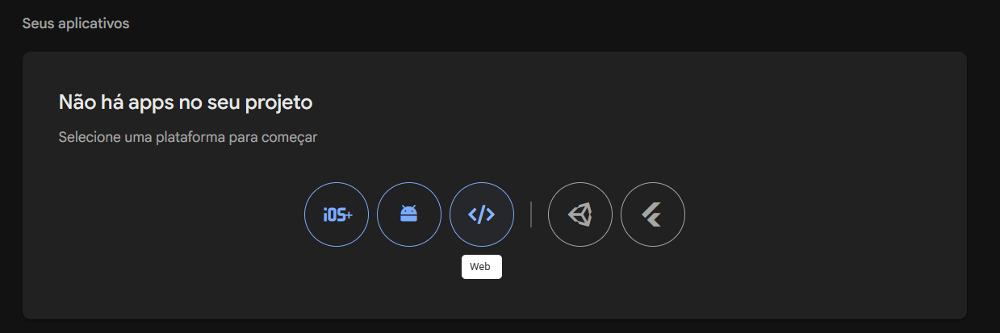
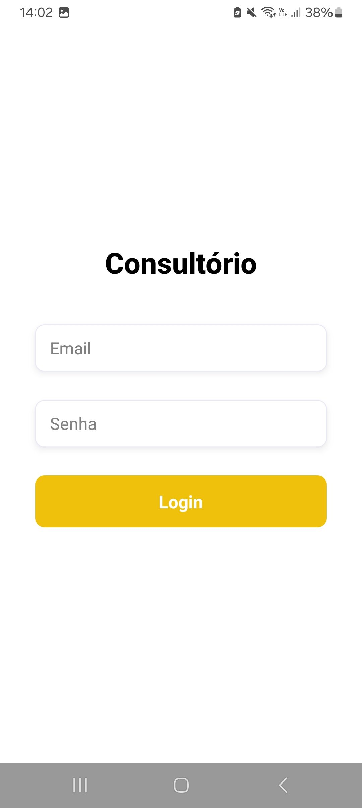
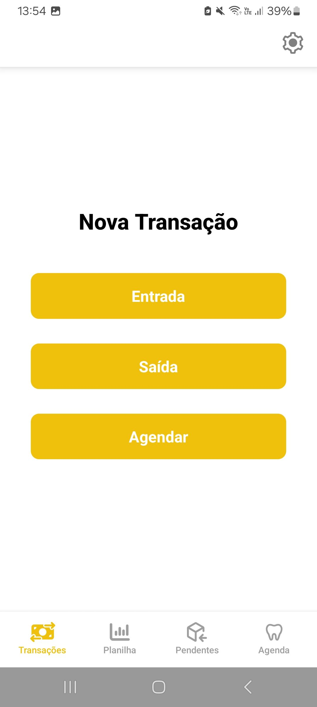
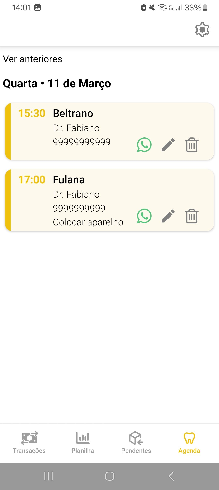
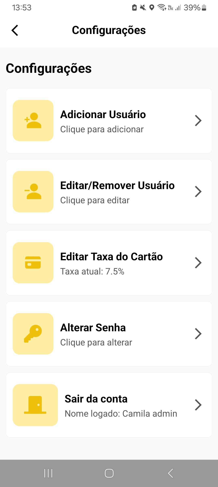

# 🦷 Consultório Dentista

Aplicativo mobile desenvolvido para auxiliar na organização de consultas e controle financeiro de um consultório odontológico.

## ✨ Funcionalidades

- 👤 Sistema de login
- 🎲 Dados salvos no Firebase
- 🎮 Controle total do administrador sobre as transações e usuários cadastrados
- 💰 Cálculos financeiros:
  - Taxa do cartão (Ajustável)
  - Taxa do dentista
- 🧾 Geração de relatórios financeiros com:
  - Divisão por mês e ano
  - Valor em caixa (dinheiro físico)
  - Valor total por dentista
  - Possibilidade de exportar para Excel
- 🗓️ Agenda de consultas marcadas:
  - Separação por dia
  - Dentistas podem marcar a consulta como concluída
  - Possibilidade de enviar uma mensagem no WhatsApp para o cliente, confirmando a consulta

## 🚀 Como usar

### ⚠️ Requisitos

- React Native + Expo instalado ([Clique aqui para ver o guia de instalação](https://reactnative.dev/docs/set-up-your-environment))
- Dispositivo Android ou emulador
- [Expo Go](https://expo.dev/go) (caso utilize dispositivo físico)

### 🔥 Configurando o Projeto Firebase

1. Acesse o console do [Firebase](https://console.firebase.google.com/?hl=pt-br)
2. Crie um novo projeto
3. Clique na engrenagem ⚙️ → Geral → Seus aplicativos → Web



4. Registre seu app e copie o firebaseConfig criado (Ele será importante)
5. Em "Criação", habilite "Authentication" (E-mail/senha) e "Firestore Database"

### 🔗 Vinculando o Firebase com o Projeto

1. Abra a pasta do app no seu editor de preferência e renomeie a pasta .env.example para somente .env
2. Coloque todas as informações do firebaseConfig do projeto que você criou lá, sem aspas ou ponto e vírgula

### 📲 Iniciando o Projeto

1. Instale as dependências:

   ```
   npm install
   ```

2. Inicie o app:

   ```
   npx expo start
   ```
3. Leia o QR code gerado no terminal pelo aplicativo da Expo Go ou abra pelo emulador

## 🔐 Primeiro Acesso

Por questões de segurança, a tela inicial é uma tela de login **sem a opção de criar uma nova conta** (afinal, somente um administrador pode criar uma nova conta). Para prosseguir, é necessário cadastrar um email e senha na parte "Authentication" do firebase, ou modificar os arquivos conforme necessário.

Se optar por criar uma conta, siga os seguintes passos para definir o primeiro administrador:
1. Crie um usuário no Firebase Authentication.
2. Copie o UID gerado.
3. Crie uma coleção `usuario` no Firestore.
4. Crie um documento com o UID como ID.
5. Adicione os seguintes campos:
  - criadoEm: timestamp
  - email: string
  - nome: string
  - role: string (digite "admin")
  - uid: string
  - porcentagem: number

Esse procedimento só será necessário uma vez, após isso, será possível criar, excluir e editar usuários dentro do próprio app (se seu role for "admin") 

## 🛠️ Tecnologias Utilizadas

- React Native
- Expo
- Firebase (Authentication + Firestore)
- TypeScript

## 📸 Fotos do App

<p align="center">
  
  
  
  
</p>

## 👨‍💻 Autora

Desenvolvido por **Camila Vidmontiene**, estudante de Ciência da Computação na [Universidade do Estado do Rio de Janeiro](https://www.uerj.br/).  